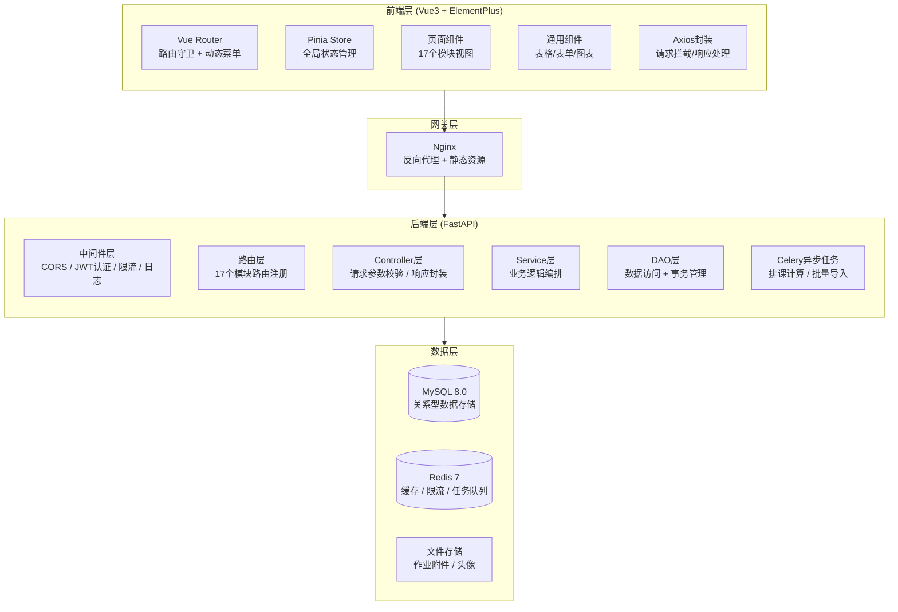
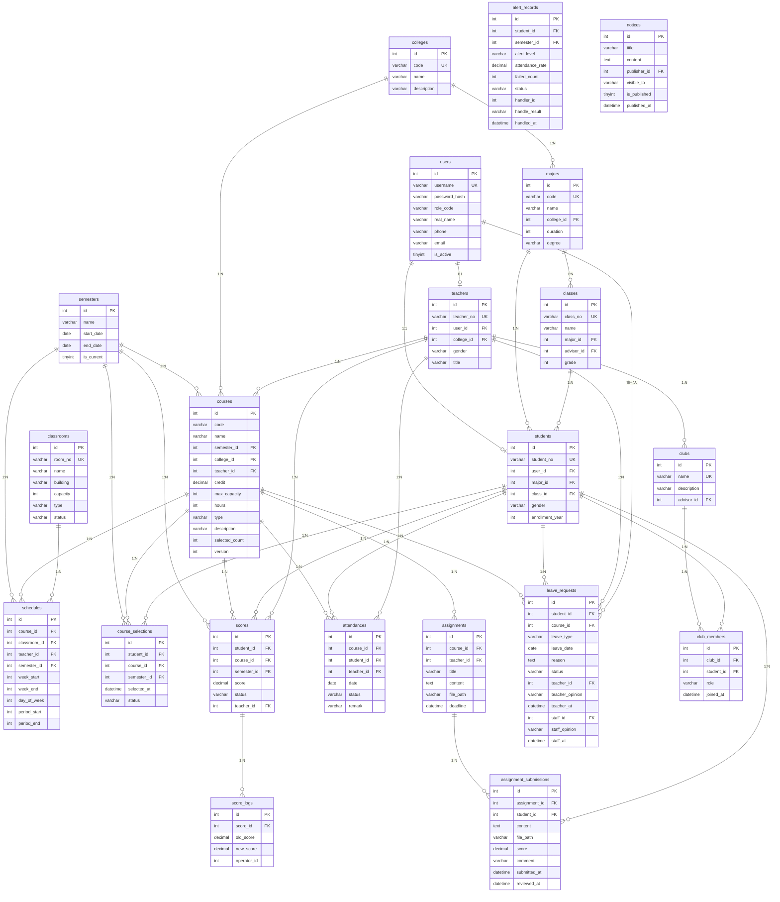

# 技术架构设计文档

## 1. 文档信息

| 项目 | 内容 |
| :--- | :--- |
| 文档版本 | v1.0 |
| 创建日期 | 2026-07-22 |
| 对应PRD版本 | v1.0 |

---

## 2. 系统模块划分



---

## 3. 项目目录结构

```
教务管理系统/
├── backend/                          # 后端项目根目录
│   ├── app/
│   │   ├── main.py                   # FastAPI 应用入口
│   │   ├── config.py                 # 配置管理（环境变量）
│   │   ├── database.py               # 数据库连接池 + Session
│   │   ├── common/                   # 通用模块
│   │   │   ├── response.py           # 统一响应封装
│   │   │   ├── exception.py          # 全局异常处理
│   │   │   ├── middleware.py         # 中间件（JWT/CORS/日志）
│   │   │   └── security.py          # JWT生成/校验、bcrypt
│   │   ├── model/                    # 数据库模型（SQLAlchemy ORM）
│   │   │   ├── user.py
│   │   │   ├── college.py
│   │   │   ├── major.py
│   │   │   ├── teacher.py
│   │   │   ├── student.py
│   │   │   ├── class_.py
│   │   │   ├── course.py
│   │   │   ├── semester.py
│   │   │   ├── classroom.py
│   │   │   ├── schedule.py
│   │   │   ├── course_selection.py
│   │   │   ├── attendance.py
│   │   │   ├── score.py
│   │   │   ├── assignment.py
│   │   │   ├── leave_request.py
│   │   │   ├── alert.py
│   │   │   ├── club.py
│   │   │   └── notice.py
│   │   ├── dto/                      # 数据传输对象（Pydantic Schema）
│   │   │   ├── user_schema.py
│   │   │   ├── college_schema.py
│   │   │   ├── ...（每个模块对应一个schema文件）
│   │   │   └── common_schema.py      # 分页、通用查询
│   │   ├── router/                   # 路由层（Controller）
│   │   │   ├── auth_router.py
│   │   │   ├── user_router.py
│   │   │   ├── college_router.py
│   │   │   ├── ...（每个模块对应一个router文件）
│   │   │   └── dashboard_router.py
│   │   ├── service/                  # 业务逻辑层
│   │   │   ├── auth_service.py
│   │   │   ├── user_service.py
│   │   │   ├── college_service.py
│   │   │   ├── ...（每个模块对应一个service文件）
│   │   │   ├── schedule_service.py   # 排课算法
│   │   │   └── selection_service.py  # 选课高并发逻辑
│   │   ├── dao/                      # 数据访问层
│   │   │   ├── user_dao.py
│   │   │   ├── college_dao.py
│   │   │   ├── ...（每个模块对应一个dao文件）
│   │   │   └── base_dao.py          # 通用CRUD基类
│   │   ├── utils/                    # 工具模块
│   │   │   ├── excel_parser.py       # Excel解析
│   │   │   ├── file_upload.py        # 文件上传
│   │   │   ├── redis_client.py       # Redis客户端
│   │   │   └── rate_limiter.py       # 限流器
│   │   └── tasks/                    # Celery异步任务
│   │       ├── __init__.py
│   │       ├── celery_app.py         # Celery配置
│   │       ├── schedule_task.py      # 排课任务
│   │       └── import_task.py        # 批量导入任务
│   ├── requirements.txt
│   ├── .env.example
│   └── alembic/                      # 数据库迁移
│       ├── env.py
│       └── versions/
│
├── frontend/                         # 前端项目根目录
│   ├── src/
│   │   ├── main.js                   # Vue应用入口
│   │   ├── App.vue                   # 根组件
│   │   ├── router/
│   │   │   ├── index.js              # 路由配置
│   │   │   └── permission.js         # 路由守卫 + 动态路由
│   │   ├── store/
│   │   │   ├── user.js               # 用户状态（登录/角色/权限）
│   │   │   ├── app.js                # 应用状态（侧边栏/主题）
│   │   │   └── modules/             # 各模块状态
│   │   ├── api/                      # 后端接口调用
│   │   │   ├── request.js            # Axios封装（拦截器）
│   │   │   ├── auth.js
│   │   │   ├── user.js
│   │   │   ├── college.js
│   │   │   └── ...（每个模块一个api文件）
│   │   ├── views/                    # 页面组件
│   │   │   ├── login/
│   │   │   ├── dashboard/
│   │   │   ├── system/              # 系统管理
│   │   │   ├── college/             # 学院专业
│   │   │   ├── teacher/
│   │   │   ├── student/
│   │   │   ├── course/
│   │   │   ├── classroom/
│   │   │   ├── schedule/
│   │   │   ├── selection/
│   │   │   ├── timetable/
│   │   │   ├── attendance/
│   │   │   ├── score/
│   │   │   ├── assignment/
│   │   │   ├── leave/
│   │   │   ├── alert/
│   │   │   ├── club/
│   │   │   └── notice/
│   │   ├── components/               # 通用组件
│   │   │   ├── layout/
│   │   │   ├── TableEx.vue
│   │   │   ├── FormEx.vue
│   │   │   └── ChartEx.vue
│   │   ├── utils/
│   │   │   ├── auth.js              # Token管理
│   │   │   └── validate.js          # 表单校验规则
│   │   └── assets/                   # 静态资源
│   ├── vite.config.js
│   ├── index.html
│   └── package.json
│
├── docs/                             # 文档
├── tests/                            # 测试
├── .gitignore
└── README.md
```

---

## 4. 数据库ER图



### 索引策略

| 表名 | 索引名 | 类型 | 字段 | 用途 |
| :--- | :--- | :--- | :--- | :--- |
| users | uk_username | UNIQUE | username | 登录查询 |
| users | idx_role_code | NORMAL | role_code | 按角色筛选 |
| courses | idx_semester | NORMAL | semester_id | 按学期查询 |
| courses | idx_teacher | NORMAL | teacher_id | 教师授课查询 |
| schedules | idx_course | NORMAL | course_id | 排课查询 |
| schedules | uk_slot | UNIQUE | classroom_id, semester_id, week_start, day_of_week, period_start | 教室冲突检测 |
| schedules | idx_teacher_week | NORMAL | teacher_id, semester_id, week_start | 教师课表 |
| course_selections | uk_student_course | UNIQUE | student_id, course_id, semester_id | 防重复选课 |
| course_selections | idx_student | NORMAL | student_id, semester_id | 学生课表 |
| attendances | uk_course_student_date | UNIQUE | course_id, student_id, date | 防重复点名 |
| scores | uk_student_course_semester | UNIQUE | student_id, course_id, semester_id | 防重复录入 |
| assignment_submissions | uk_assignment_student | UNIQUE | assignment_id, student_id | 防重复提交 |
| club_members | uk_club_student | UNIQUE | club_id, student_id | 防重复加入 |
```

### 外键关系汇总

| 子表 | 外键字段 | 父表 | 关系 | 级联策略 |
| :--- | :--- | :--- | :--- | :--- |
| teachers | user_id | users | 1:1 | CASCADE |
| students | user_id | users | 1:1 | CASCADE |
| majors | college_id | colleges | N:1 | RESTRICT |
| classes | major_id | majors | N:1 | RESTRICT |
| classes | advisor_id | teachers | N:1 | SET NULL |
| students | major_id | majors | N:1 | RESTRICT |
| students | class_id | classes | N:1 | RESTRICT |
| courses | semester_id | semesters | N:1 | RESTRICT |
| courses | college_id | colleges | N:1 | RESTRICT |
| courses | teacher_id | teachers | N:1 | RESTRICT |
| schedules | course_id | courses | N:1 | CASCADE |
| schedules | classroom_id | classrooms | N:1 | RESTRICT |
| course_selections | student_id | students | N:1 | CASCADE |
| course_selections | course_id | courses | N:1 | CASCADE |
| attendances | course_id | courses | N:1 | CASCADE |
| attendances | student_id | students | N:1 | CASCADE |
| scores | student_id | students | N:1 | CASCADE |
| scores | course_id | courses | N:1 | CASCADE |
| score_logs | score_id | scores | N:1 | CASCADE |
| assignments | course_id | courses | N:1 | CASCADE |
| assignment_submissions | assignment_id | assignments | N:1 | CASCADE |
| assignment_submissions | student_id | students | N:1 | CASCADE |
| leave_requests | student_id | students | N:1 | CASCADE |
| leave_requests | course_id | courses | N:1 | CASCADE |
| clubs | advisor_id | teachers | N:1 | RESTRICT |
| club_members | club_id | clubs | N:1 | CASCADE |
| club_members | student_id | students | N:1 | CASCADE |
| alert_records | student_id | students | N:1 | CASCADE |
| alert_records | semester_id | semesters | N:1 | RESTRICT |
| notices | publisher_id | users | N:1 | RESTRICT |
