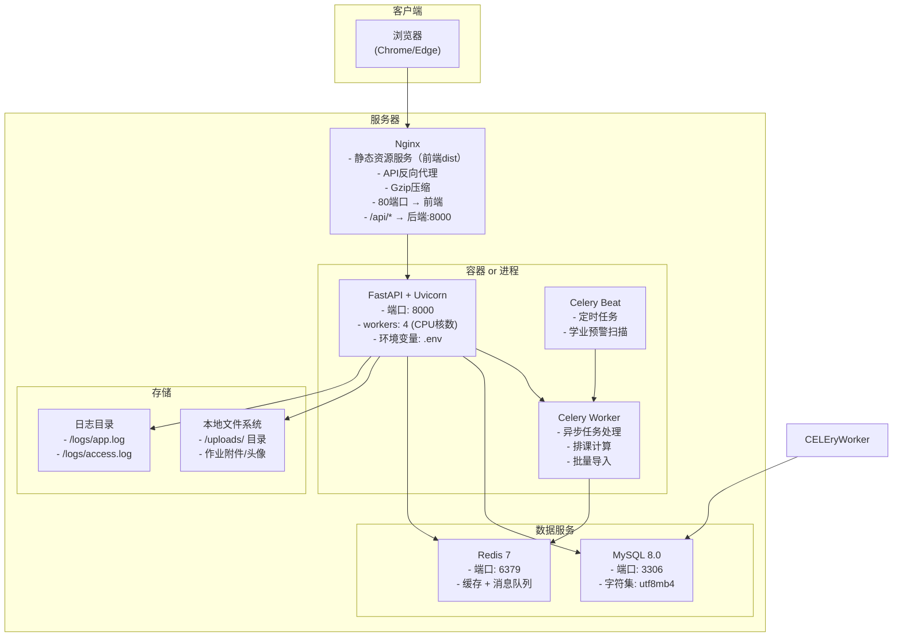

# 部署架构与基础设施

## 1. 部署架构图



## 2. 环境变量配置

### 后端 .env 文件结构

```ini
# 应用配置
APP_NAME=教务管理系统
APP_VERSION=1.0.0
DEBUG=False
SECRET_KEY=your-secret-key-change-in-production

# 数据库配置
DB_HOST=localhost
DB_PORT=3306
DB_USER=root
DB_PASSWORD=root
DB_NAME=edu_management
DB_POOL_SIZE=20
DB_POOL_RECYCLE=3600

# Redis配置
REDIS_HOST=localhost
REDIS_PORT=6379
REDIS_DB=0
REDIS_PASSWORD=

# JWT配置
JWT_SECRET_KEY=your-jwt-secret-key
JWT_ALGORITHM=HS256
JWT_EXPIRE_MINUTES=120

# Celery配置
CELERY_BROKER_URL=redis://localhost:6379/1
CELERY_RESULT_BACKEND=redis://localhost:6379/2

# 文件上传
UPLOAD_DIR=./uploads
MAX_UPLOAD_SIZE=10485760   # 10MB

# 日志
LOG_LEVEL=INFO
LOG_DIR=./logs
```

### 前端 .env 文件结构

```ini
VITE_API_BASE_URL=http://localhost:8000/api/v1
VITE_APP_TITLE=教务管理系统
```

## 3. 开发环境启动

### 后端启动

```bash
# 1. 激活conda环境
conda activate demo2

# 2. 安装依赖
cd backend
pip install -r requirements.txt

# 3. 配置环境变量（复制并修改 .env.example）
cp .env.example .env

# 4. 确保MySQL服务已启动，创建数据库
mysql -u root -proot -e "CREATE DATABASE IF NOT EXISTS edu_management CHARACTER SET utf8mb4 COLLATE utf8mb4_unicode_ci;"

# 5. 运行数据库迁移
alembic upgrade head

# 6. 启动后端服务
uvicorn app.main:app --host 0.0.0.0 --port 8000 --reload

# 7. 启动Celery Worker（另一个终端）
celery -A app.tasks.celery_app worker --loglevel=info --pool=solo

# 8. 启动Celery Beat（另一个终端，定时任务）
celery -A app.tasks.celery_app beat --loglevel=info
```

### 前端启动

```bash
# 1. 安装依赖
cd frontend
npm install

# 2. 配置环境变量
# 创建 .env.development 文件

# 3. 启动开发服务器
npm run dev
```

### 访问地址

| 服务 | 地址 |
| :--- | :--- |
| 前端页面 | http://localhost:5173 |
| 后端API文档（Swagger） | http://localhost:8000/docs |
| 后端API文档（ReDoc） | http://localhost:8000/redoc |
| MySQL | localhost:3306 |
| Redis | localhost:6379 |

## 4. 生产环境部署

### Nginx 配置示例

```nginx
server {
    listen 80;
    server_name edu.example.com;

    # 前端静态资源
    root /var/www/edu-management/frontend/dist;
    index index.html;

    # 前端路由（SPA）
    location / {
        try_files $uri $uri/ /index.html;
    }

    # API反向代理
    location /api/ {
        proxy_pass http://127.0.0.1:8000;
        proxy_set_header Host $host;
        proxy_set_header X-Real-IP $remote_addr;
        proxy_set_header X-Forwarded-For $proxy_add_x_forwarded_for;
        proxy_set_header X-Forwarded-Proto $scheme;
    }

    # 静态文件缓存
    location ~* \.(js|css|png|jpg|jpeg|gif|ico|svg)$ {
        expires 30d;
        add_header Cache-Control "public, immutable";
    }
}
```

### 系统依赖清单

| 依赖 | 开发环境 | 生产环境 |
| :--- | :--- | :--- |
| Python | 3.13.14 (conda demo2) | 3.12+ |
| Node.js | 18+ | 18+ LTS |
| MySQL | 8.0.12 | 8.0+ |
| Redis | 7.x | 7.x |
| Nginx | 不需要（Vite代理） | 1.24+ |
